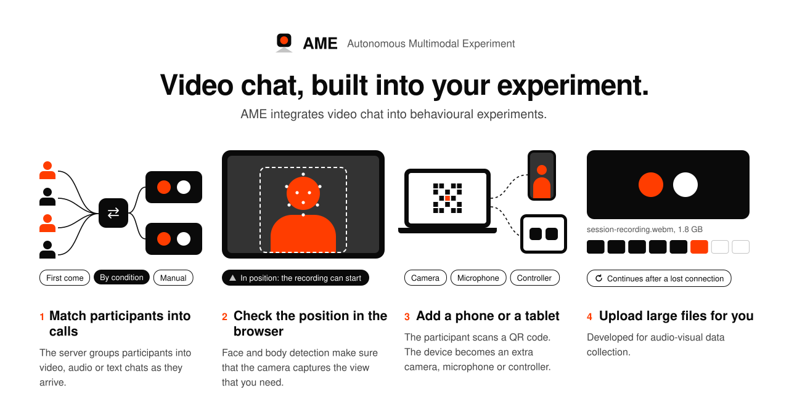
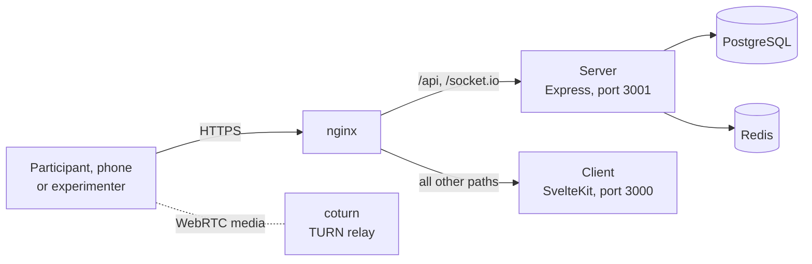

<p align="center">
  <picture>
    <source media="(prefers-color-scheme: dark)" srcset="docs/assets/readme-banner-dark.svg">
    
  </picture>
</p>

<p align="center">
  <a href="LICENSE"></a>
  <a href="#requirements"></a>
</p>

AME (say "a-meh") is a web platform for behavioural science. Researchers use
it to design, run and manage online experiments that collect multimodal data:
video, audio, body movement, speech and responses.

AME runs each session without an experimenter. The server puts participants
into video calls, gives each participant their steps, checks their position
on the camera and stores their data.

We run a hosted version at [ameexp.com](https://ameexp.com). Its
[documentation](https://ameexp.com/docs) explains each element and routine.
This repository holds the full source code, so that you can run AME on your
own server.

## Contents

- [Why AME](#why-ame)
- [Quick start](#quick-start)
- [How an experiment is built](#how-an-experiment-is-built)
- [Elements](#elements)
- [Features](#features)
- [Set up a production server](#set-up-a-production-server)
- [Configuration](#configuration)
- [Development](#development)
- [Citation](#citation)

## Why AME

Most online experiment tools show stimuli and collect clicks. Studies of
face-to-face interaction need more: live video between participants,
audio-visual recordings and control of who meets whom. Usually, an
experimenter must join each session to do these tasks. AME does them
automatically:

- The server puts participants into video calls by rules that you set.
- Models in the browser find the face, the hands and the body. They make sure
  that a participant sits correctly before the recording starts. No video
  goes to a server for this check.
- A phone can join as a second camera or as a controller. The participant
  scans a QR code to connect it.
- The server sends each step over a WebSocket and keeps the state of each
  participant. A participant who loses the connection continues from the
  same step.

## Quick start

### Requirements

- Node.js 20.6 or later
- PostgreSQL
- Redis
- A browser with WebRTC. We recommend a recent version of Chrome.

### Install

1. Clone the repository.

   ```bash
   git clone https://github.com/JH-Eric-Yang/AME.git
   cd AME
   ```

2. Start PostgreSQL and Redis.

3. Run the setup script.

   ```bash
   ./scripts/setup.sh
   ```

4. Start the server.

   ```bash
   npm run dev --workspace server
   ```

5. In a second terminal, start the client.

   ```bash
   npm run dev --workspace client
   ```

6. Open <http://localhost:5173/admin/login> and log in as the administrator.

The setup script checks the requirements and makes `.env` with a random JWT
secret. Then it installs the packages, applies the database migrations and
makes the first administrator account. You can run it again: it keeps an
existing `.env` and an existing account.

To add an example experiment, run `npm run seed:demo`.

New experimenters register on the login page. An administrator approves each
new account in the **Accounts** tab of the dashboard.

<details>
<summary>Set up without the script</summary>

1. Copy `.env.example` to `.env` and set the values.
2. Install the packages.

   ```bash
   npm install
   ```

3. Apply the database migrations.

   ```bash
   cd server
   npx prisma migrate deploy
   ```

4. Make the first administrator account. Give the account in the shell, so
   that the password does not stay in a file.

   ```bash
   ADMIN_EMAIL=you@example.org ADMIN_NAME="Your Name" ADMIN_PASSWORD='…' npx prisma db seed
   ```

</details>

## How an experiment is built

An experiment has four levels.

```
Experiment
└── Progress     one step in the sequence, and the unit of randomization
    └── Routine  the layout of the step
        └── Element  a stimulus, a response or a monitor
```

| Level | What it does |
|---|---|
| **Experiment** | Holds the global parameters: AV recording, body detection, video chat, supplementary device, active time, roll-back time, participants per session, randomization and conditions. |
| **Progress** | One step in the sequence. Each condition has its own sequence of steps. |
| **Routine** | The layout of a step. A routine holds one or more element sets. In a group session, each participant sees only their own set. |
| **Element** | The smallest part. An element shows a stimulus, collects a response or monitors the participant. |

AME has these predefined routines:

- **Layout:** `routine-borderless`, `routine-card`
- **Function:** `routine-consent`, `routine-end`, `routine-pos-check`,
  `routine-matching`, `routine-video-chat`, `routine-end-matching`,
  `routine-survey`

Elements send four types of events:

| Event | Result |
|---|---|
| **Data** | Keeps a value in the browser until the next Proceed event. |
| **Proceed** | Ends the routine, uploads the data and goes to the next step. |
| **Complete** | Ends the experiment and records completion or withdrawal. |
| **Alert** | Pauses the experiment with a message and records the alert. |

## Elements

Each element belongs to one family. The Builder shows the family with the
same shape as below.

| Family | Elements |
|---|---|
|  **Stimulus** | text, image, video, audio, video-chat |
|  **Response** | recorder, keyboard, button, input-textfield, input-select, input-option-group, input-slider, input-file-picker, survey |
|  **Monitor** | body-detector, facial-expression-detector, speech-recognizer, volume-check, timer |

Body, hand and face detection use
[MediaPipe](https://developers.google.com/mediapipe) in the browser.

## Features

**Visual builder.** Put elements on a canvas, set their parameters and see
the result immediately.

**Conditions and randomization.** Give each condition its own sequence of
steps. Shuffle ranges of trials.

**Participant matching.** Each video-chat routine has its own matching rule.
*FIFO* groups participants in the order that they arrive. *Condition-aware*
groups participants from different conditions, for example one from group A
and one from group B. *Manual* lets the experimenter assign the groups in the
dashboard.

**Video chat.** Native WebRTC with Socket.IO signalling. A TURN relay
connects participants on networks that block a direct connection.

**Recording.** Audio and video come from the webcam. The browser uploads them
in resumable chunks (tus protocol), so a slow network does not lose a
recording.

**Supplementary device.** A phone streams its camera to the desktop or acts
as a controller.

**References.** A later step can use an earlier response. For example, it
can replay a participant's own recording or show their typed answer.

**Resume.** External IDs, for example `PROLIFIC_PID`, let a participant
continue in a different browser.

**Results.** Export the responses as CSV and the media files as a ZIP
archive.

## Set up a production server

`scripts/deploy.sh` sets up AME on a fresh Ubuntu server (22.04 or later).

> [!WARNING]
> Browsers give camera access only on an HTTPS page. Point the DNS record of
> your domain to the server before you start, so that the script can get a
> certificate.

1. Open ports 22, 80 and 443 in the firewall of your cloud provider. For the
   TURN relay, also open 3478 (UDP and TCP) and 49160–49200 (UDP).
2. Clone the repository on the server and run the script as root.

   ```bash
   git clone https://github.com/JH-Eric-Yang/AME.git
   cd AME
   sudo ./scripts/deploy.sh
   ```

3. Give the domain, the administrator account and your TURN choice when the
   script asks for them.

The script installs Node.js, PostgreSQL, Redis, nginx, certbot, PM2 and
(optionally) coturn. It runs AME as the system user `ame` from `/opt/ame`.
The configuration is in `/opt/ame/.env`.



One Express process serves the REST API, Socket.IO and the tus uploads.

To install a new version, run `sudo /opt/ame/scripts/update.sh`.

## Configuration

The server and the client both read `.env` in the repository root.
`.env.example` shows each value.

| Variable | Required | Description |
|---|---|---|
| `DATABASE_URL` | Yes | The PostgreSQL connection string. |
| `REDIS_URL` | Yes | The Redis connection string. |
| `JWT_SECRET` | Yes | A long random string. The server signs login tokens with it. In production, the server does not start without it. |
| `PORT` | No | The server port. The default is `3001`. |
| `CLIENT_URL` | No | The client origin. In production, the server accepts requests only from it. |
| `VITE_SERVER_URL` | In production | The URL at which the browser reaches the server, for example `https://ame.example.org`. The client reads it when you build it. In development, leave it empty. |
| `TURN_URLS` | No | TURN server URLs, separated by commas. Use with `TURN_SECRET`. |
| `TURN_SECRET` | No | The shared secret of the TURN server (coturn `use-auth-secret`). |
| `TURN_TTL_SECONDS` | No | How long a TURN password stays valid. The default is 4 hours. |

> [!CAUTION]
> Do not serve the TURN secret or a TURN password from an open URL. Other
> people can then use your relay. The server sends a short-lived TURN
> password only to a participant who joined an experiment.

## Development

### Stack

| Layer | Technology |
|---|---|
| Frontend | SvelteKit, Svelte 5, TypeScript |
| Backend | Express, TypeScript |
| Database | PostgreSQL with Prisma |
| Cache | Redis (waiting rooms and the Socket.IO adapter) |
| Realtime | Socket.IO |
| Video | Native WebRTC |
| Upload | tus (resumable chunked upload) |
| Authentication | JWT and bcrypt |
| Production | PM2 and nginx |

### Project structure

```
AME/
├── client/    SvelteKit app: dashboard, experiment runner, phone page
├── server/    Express app: REST API, Socket.IO handlers, Prisma schema
├── shared/    TypeScript types and helpers for the client and the server
├── scripts/   Setup, deploy and update scripts, and example experiments
└── e2e/       Playwright end-to-end tests
```

### Tests

Run these commands from the repository root.

```bash
npm test --workspace server   # server unit tests (vitest)
npm test --workspace client   # client unit tests (vitest)
npm run test:e2e              # end-to-end tests (Playwright)
```

The end-to-end tests need PostgreSQL, Redis, `ffmpeg` and `ffprobe`, with the
migrations applied. Playwright starts its own server and client, and makes a
temporary experiment.

## Citation

If you use AME in your research, please cite:

> Yang, J., & Kita, S. *AME: The Autonomous Multimodal Experiment System.*
> Manuscript in preparation. https://ameexp.com

We will add the full reference when the paper is published.

## Authors

- **Jiahao Eric Yang**, University of Bath
- **Sotaro Kita**, University of Warwick

To contact us, use the contact form on [ameexp.com](https://ameexp.com).

## Funding

We thank the ESRC Impact Acceleration Account and the EPSRC Impact
Acceleration Account for their funding.

## License

AME is released under the [MIT License](LICENSE).
